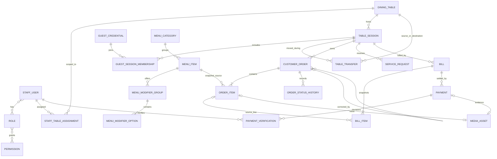

# Phase 2 database model

## Scope and shared conventions

The MVP database belongs to one venue installation. There are no tenant or
branch identifiers. Ent schemas in `services/backend/ent/schema` are the
application schema source of truth; generated Ent types are persistence types,
not domain types.

All primary keys are UUIDs. Mutable records carry `created_at` and
`updated_at`; event/history rows carry immutable `created_at`. Go-generated
timestamps use UTC, and PostgreSQL timestamp columns use `timestamptz` with
`CURRENT_TIMESTAMP` defaults where shared identity timestamps are used.

Money is stored as signed 64-bit integer **santim** amounts: 100 santim = 1 ETB.
Menu prices, order and bill snapshots, and payment amounts use this unit, so no
binary floating-point rounding is involved. Persisted item/payment amounts are
nonnegative; modifier price deltas may be negative. The venue is ETB-only for
this MVP, so currency is not repeated on each row. VAT/service calculation
order and rates remain settings/business-policy decisions; bills preserve the
calculated component amounts and never recompute old rows after settings change.

## Entity inventory

| Entity | Purpose and important relationships |
|---|---|
| `StaffUser` | Staff login, display name, active state, and password hash; many-to-many roles; table assignments and actions. |
| `Role` | Named permission grouping; many-to-many staff users and permissions. |
| `Permission` | Atomic permission code and description; many-to-many roles. |
| `StaffTableAssignment` | Waiter/table scope, with revocation timestamp and a partial unique index preventing duplicate current assignments while retaining history. |
| `DiningTable` | Venue table label, signed-QR token hash, enabled state, and sort position. Occupancy is derived from its active session. |
| `TableSession` | One dining visit, tied to its current table; stores active/idle/closed/cancelled lifecycle and server activity times. Historical idle sessions remain. |
| `GuestCredential` | One browser/device credential; stores SHA-256 token hash, expiry/revocation, and label. Never stores the bearer token. |
| `GuestSessionMembership` | Many-to-many membership between device credentials and sessions, with join/leave times. Unique credential/session pair prevents duplicate memberships. |
| `TableTransfer` | Append-only source, destination, session, guest actor, reason, and UTC time for a guest table transfer. The session's current table changes in the same application transaction. |
| `MenuCategory` | Bilingual category names, display order, and active state. |
| `MenuItem` | Bilingual name/description, price, availability, prep time, allergens, and category; menu rows are deactivated instead of deleted when order history references them. |
| `MenuModifierGroup` | Item-specific option group and minimum/maximum selections. |
| `MenuModifierOption` | Group option, availability, bilingual name, and signed price delta. |
| `CustomerOrder` | Session order, optional placing credential, lifecycle status, guest note, timestamps, and optional link/reason for a correction order. Corrections are new rows. |
| `OrderItem` | Order line with catalog link plus immutable name, unit-price, quantity, customization JSON, note, and optional protected voice attachment. |
| `OrderStatusHistory` | Append-only order state transition and actor snapshot, indexed by order/time. |
| `ServiceRequest` | Assistance, water, additional items, bill, and customer issue requests; records source table/session, guest, lifecycle, and optional assigned staff member. |
| `Bill` | Session bill revision, status, item totals, tax/service components, total, applied payments, and issue/paid times. |
| `BillItem` | Immutable itemized bill name/quantity/unit/line amount, optionally linked to its source order line. |
| `Payment` | Bill payment method/status/amount, customer-reported reference, provider transaction and idempotency keys, cash received/applied/change figures, and evidence metadata link. |
| `PaymentVerification` | Append-only staff decision and note for each electronic transfer verification attempt. A reference or screenshot alone never verifies payment. |
| `BusinessSetting` | Keyed JSON venue configuration, including future session expiry/activity and billing settings; no policy defaults are invented here. |
| `Notification` | Durable in-app notification content and optional staff/guest/session target. Delivery is outside this database phase. |
| `AuditRecord` | Append-only sensitive action record with actor and polymorphic subject UUID plus before/after snapshots. Specialized order, transfer, and payment history remains in their own tables. |
| `OutboxEvent` | Business event payload, aggregate identity, unique idempotency key, pending/published status, retry time, and lease fields for safe future worker claims. |
| `MediaAsset` | Protected local-storage metadata (opaque key, type, size, hash, duration) linked to voice instructions or payment evidence; no public URL is stored. |

## Important database invariants

- `table_sessions` has a unique index on its table FK **where `status = 'active'`**.
  This PostgreSQL partial unique index allows any number of idle/closed historical
  sessions while preventing two active sessions for one table. Ent's PostgreSQL
  `IndexWhere` annotation expresses this rule in the schema source; it is not a
  post-generation manual index that would drift from Ent.
- Guest tokens and table QR tokens are represented by unique 64-character
  SHA-256 hex hashes. Raw guest bearer credentials are not database values.
- Session membership has a unique credential/session pair; one credential can
  still join several sessions.
- Menu item/order and order item/bill rows retain name, quantity, customization,
  and integer santim price snapshots. Historical orders and bills do not depend
  on current menu names/prices.
- Payment status is distinct from a customer report. Electronic payments enter
  pending verification and each staff decision is retained. Cash can be marked
  received only with an amount received; amount applied and change are separate
  values. Authorization of who may do that remains application policy.
- Foreign keys retain business history by default. Deactivation/status changes
  are the normal lifecycle; deleting a referenced menu row or staff actor should
  not cascade through orders, payments, or audit records.
- Business rules that require atomic multi-row behavior (session transfer,
  bill settlement, order plus outbox write) remain application transaction
  responsibilities; the schema provides the references and uniqueness checks.

## Relationship diagram

Staff authorization, notification delivery, transactional outbox publishing,
and protected filesystem behavior are deliberately not implemented by this
schema phase.
